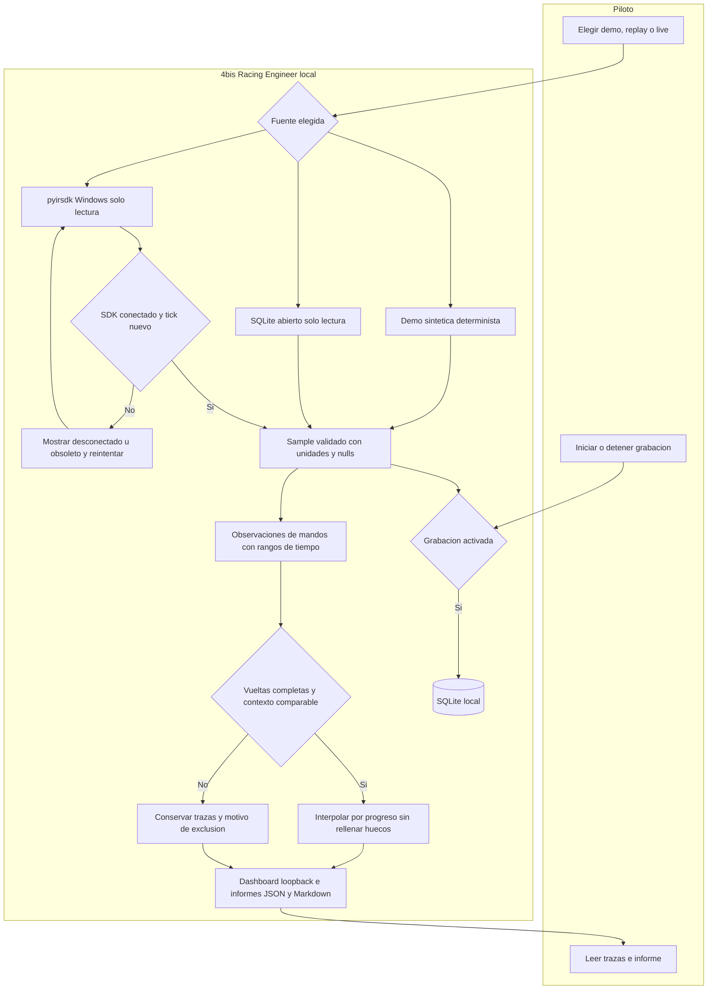

# Flujo local implementado

`model.py` define el contrato común; `demo.py` produce muestras sintéticas;
`iracing.py` encapsula el ciclo read/close del SDK sin comandos al juego;
`storage.py` graba y reproduce; `analysis.py` delimita vueltas y hallazgos;
`app.py` coordina lectura y HTTP; `dashboard.html` dibuja las trazas.

El adaptador no depende del dashboard ni del grabador. Los mocks entran por el
constructor de `IRacingSource`; no se añadió una jerarquía de clases de una sola
implementación. Un lock de la app serializa SQLite y muestras; si se requiere
captura de alta frecuencia, el siguiente incremento debe medir latencia y separar
la escritura por lotes, conservando errores y cierre seguro.
